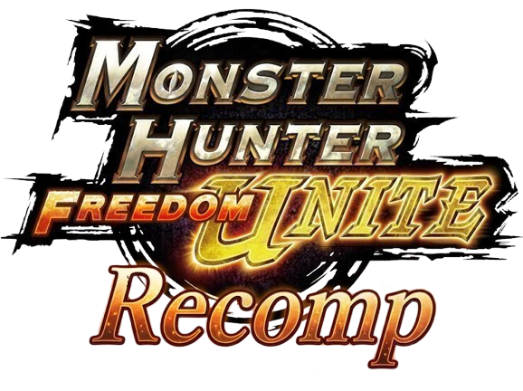

<h1 align="center">
  <br>
  Monster Hunter: Freedom Unite Recomp
</h1>

<p align="center">
  <b>Monster Hunter Freedom Unite on PC and Android: an unofficial native port through static recompilation.</b>
</p>

<p align="center">
  <a href="https://github.com/PateeerQ/FreedomUniteRecomp/releases/latest"></a>
  <a href="https://github.com/PateeerQ/FreedomUniteRecomp/releases"></a>
  <a href="LICENSE"></a>
  
  
  <a href="https://github.com/sp00nznet/psprecomp"></a>
</p>

<p align="center">
  <a href="#download">Download</a> ·
  <a href="#getting-started">Getting started</a> ·
  <a href="#multiplayer">Multiplayer</a> ·
  <a href="#building-from-source">Building</a> ·
  <a href="#credits">Credits</a> ·
  <a href="#license">License</a>
</p>

---

*Monster Hunter Freedom Unite* (PSP) recompiled ahead of time from its MIPS code into C, then built as a native
program for **Windows** and **Android**: no emulator runs the game. It adds what the PSP never had: online rooms
anyone can join with a code, 60 FPS, widescreen, controllers, rearrangeable touch buttons and RetroAchievements.

**Maintained by [PateeerQ](https://github.com/PateeerQ).**

> [!IMPORTANT]
> Not affiliated with, endorsed by or sponsored by Capcom or Sony. You need your own copy of the game.
> No game data is included or downloaded: no disc image, EBOOT, firmware fonts, textures, audio or saves.
> "Monster Hunter" is a trademark of Capcom and is used here only to say which game this works with.

## Highlights

|  |  |
|---|---|
| **Native** | The EBOOT and all 298 overlays (menus, stages, monsters) recompiled to C; firmware reimplemented in the host |
| **Online play** | **Create Server / Join Server** with room codes and optional passcodes, on your Wi-Fi or over the internet relay; no port forwarding. PC and phone in the same room. Room chat and ping |
| **60 FPS (beta)** | The game at 60 fps and normal speed. A room plays at its slowest player's rate |
| **One app, every release** | Europe, USA, Japan and the FUComplete translation from one launcher and one app, told from your disc; every release can share a room |
| **Mods** | Widescreen, CWCheat cheats, and built-in mods: Target Camera + Crosshair, Damage Numbers, Gathering Node Indicators |
| **Texture packs** | HD packs made for PPSSPP (PNG or KTX2, with their style variants), optional |
| **Android** | Touch buttons you can move and resize, a swipe camera, weapon buttons that change with your weapon, a save folder you choose |
| **PC launcher** | Profiles, upscaling, fullscreen, key bindings, controller tester, RetroAchievements, update check, log |
| **Controllers** | DualSense, DualShock, Xbox and more (SDL3); the right stick moves the camera |
| **RetroAchievements** | Sign in once; unlocks pop up in game (softcore) |

## Supported games

| Game | Region | ID | Status |
|---|---|---|---|
| Monster Hunter Freedom Unite | Europe | `ULES01213` | **Playable**: village, Gathering Hall, quests, online |
| Monster Hunter Freedom Unite | North America | `ULUS10391` | **Playable**: quests on PC and Android, 60 FPS, the built-in mods, online with every release |
| Monster Hunter Portable 2nd G | Japan | `ULJM05500` | **Playable**: quests on PC and Android, 60 FPS, the built-in mods, online with every release |
| FUComplete (MHP2G English translation) | — | `ULJM05500` | **Playable**: the translated `.iso` as it is, no EBOOT dump needed |

## Download

Get the newest build from **[Releases](https://github.com/PateeerQ/FreedomUniteRecomp/releases/latest)**.

| Platform | File | Needs |
|---|---|---|
| Windows 10/11 x64 | `FreedomUniteRecomp-v<version>-windows-x64-universal.zip` | OpenGL 3.3 GPU |
| Android 8+ arm64 | `FreedomUniteRecomp-v<version>-android-arm64-universal.apk` | OpenGL ES 3.0 GPU |

Both check for updates by themselves (the launcher on PC, the app at start or from its menu).

## Status

Version **0.4.3**. The game boots, plays its movies, creates and saves a character, and runs the village,
the Gathering Hall and quests in 3D at its own 30 fps, or 60 in 60 FPS mode, with sound, music, keyboard,
controllers and touch buttons. Quests have been played start to finish, alone and together through a room, on
PC and on Android (Poco X7 Pro).

<details>
<summary><b>Progress by area</b> (rough estimates, 2026-11-06)</summary>

<br>

"Recompiled" means the code builds and is switched in when the game loads it; "tested" means someone has played through it.

| Area | Progress | Notes |
|---|---|---|
| CPU recompilation (Allegrex + VFPU) |  | EBOOT and every overlay recompile; VFPU ops checked against PPSSPP as they turn up |
| Game overlays, recompiled |  | 298 of 298, extracted from DATA.BIN (`tools/re/databin.py`) |
| Game overlays, tested in game |  | menus, village, house, Training School, Gathering Hall, quests on most maps (estimate) |
| System modules (firmware HLE) |  | threads, I/O, UMD/ISO, display, ctrl, utility dialogs, savedata, libfont, sceMpeg, sceAtrac, sceNetAdhoc, Netconf; missing: encrypted saves, the sound PRX |
| Graphics (GE + GL renderer) |  | textures, lighting, fog, skinning, clipping, render-to-texture, GL 3.3 and GLES 3.0; missing: stencil, colour test, logic op, mipmaps, culling, DXT, specular, points/lines |
| Audio |  | sound effects, music (ATRAC3/3+ via FFmpeg), movie sound; small gaps while loading |
| Movies |  | H.264 + ATRAC3+ via FFmpeg, own PSMF demuxer |
| Input |  | keyboard, mouse camera, controllers, touch buttons with a layout editor, swipe camera, weapon buttons |
| Save data |  | save and load; saves from a PSP or PPSSPP (encrypted) load too; on Android a save folder of your choice, kept in sync |
| Multiplayer (ad hoc over rooms) |  | LAN and internet rooms, passcodes, chat, ping, 60 fps rooms, every release in one room with its name shown; Gathering Hall and quests together; movement in the hall lags |
| Mods |  | widescreen, CWCheat cheats, three built-in code mods in every release |
| Texture packs |  | PPSSPP packs (quick/xxh32/xxh64 hashes, PNG, KTX2 as ASTC/BC7), styles from ADDONS; tested on PC, not yet on a phone |
| Performance |  | being worked on for low-end phones: the GE's vertex work is done on the CPU; vertex reads made direct (village about 18% lighter on PC) |
| RetroAchievements |  | sign-in, game identified, unlock toasts (softcore); not yet checked against a real unlock |
| Gameplay coverage |  | village life, full quests, the Gathering Hall together; more maps and monsters untested |
| PC release (launcher) |  | launcher, profiles, keys, controllers, achievements, mods, 60 FPS, updates, log, crash report |
| Android port |  | 30 or 60 fps, touch buttons, layout editor, drawer menu, multiplayer, achievements, mods, save folder, crash log, updates |
| USA release (`ULUS10391`) |  | 60 FPS and the built-in mods; quests on Android with the mods and weapon buttons, in one room with an EU player |
| Japan release (`ULJM05500`) |  | 60 FPS and the built-in mods; quests and area changes on PC and Android, in one room with an EU player |
| FUComplete |  | the English translation's own code and voices; checked on PC and Android |

</details>

It is early software: expect rough edges, and please report crashes (both apps can copy their crash log for you).

## Getting started

You need your own copy of the game and three files made from it:

1. **the disc image** as an `.iso`: Freedom Unite Europe (`ULES01213`) or USA (`ULUS10391`), Portable 2nd G
   (`ULJM05500`), or the FUComplete translation
2. **its decrypted EBOOT**: in PPSSPP, *Settings → Tools → Developer tools → "Dump decrypted EBOOT.BIN on game
   boot"* (gives `<game id>_EBOOT.BIN`); not needed for FUComplete
3. **the PSP's fonts**: the `.pgf` files from PPSSPP's `assets/flash0/font`

### Windows

1. Unzip `FreedomUniteRecomp-v<version>-windows-x64-universal.zip`.
2. Put the fonts in `work\root\flash0\font`.
3. Run `mhfu_launcher.exe`, choose the ISO and the EBOOT under **Advanced**, then press **DEPART** on the Play page.

<details>
<summary><b>Keyboard and mouse</b></summary>

<br>

| Key | PSP |
|---|---|
| W / A / S / D | analog stick |
| Arrow keys | D-pad (camera) |
| K or Space / L / J / I | Cross / Circle / Square / Triangle |
| Q / E | L / R |
| Enter / V or Backspace | Start / Select |
| F3 / F4 | FPS line / 60 FPS mode |
| F5 / F6 | volume down / up |
| F7 | mouse look on/off |
| Right mouse button held | mouse camera |
| F9 | memory dump (for cheat makers) |

Keys can be rebound on the launcher's Keyboard page. The game window's **Options** menu sets the volume, the mouse
camera's sensitivity, mouse look and mods.

</details>

### Android

1. Install `FreedomUniteRecomp-v<version>-android-arm64-universal.apk` (arm64, Android 8+).
2. Put the ISO and the EBOOT in one folder on the phone.
3. Open the app and pick that folder (*"Use this folder"*). After that it goes straight into the game.

The fonts are taken from PPSSPP when it is installed; otherwise put the `.pgf` files in that folder too.

- **Touch buttons**: stick, D-pad, face buttons, L/R, Select/Start. In a quest with the weapon drawn they become an
  attack pad, Dodge, Sheathe and buttons for your weapon (guard, aim, charge, Demon Mode, Spirit). Hidden while a
  controller is connected.
- **Camera**: drag a finger anywhere away from the buttons.
- **Menu**: swipe in from the left edge, press Back, or tap the menu button: Multiplayer, RetroAchievements, button
  layout and opacity, resolution, 60 FPS, mods, cheats, save folder, crash log, updates.
- **Save folder**: like PPSSPP's memory stick folder. Choose a folder you can see (for example `Documents/MHFU`) and
  your saves survive reinstalling, and saves from a PC can be brought in.

### 60 FPS mode (beta)

The game normally runs at the PSP's 30 fps. With **60 FPS (beta)** on (the launcher's checkbox or F4 on Windows,
the menu on Android) it runs at 60 at normal game speed: the community "60 FPS" cheat for `ULES01213` is built into
the recompiled code. Online, a room runs at its slowest player's rate (the chat says who).

### Mods and cheats

- **Widescreen**: the camera's view fills a wide screen.
- **Built-in mods** (on by default, each can be turned off): Target Camera + Crosshair, Damage Numbers, Gathering
  Node Indicators.
- **Cheats**: CWCheat codes, as PPSSPP runs them, from `cheats/ULES01213.ini`; the launcher and the app can fetch
  the CWCheat Database. Cheats pause in online rooms, and achievements stop unlocking while one is on.

## Multiplayer

1. One player chooses **Create Server** (optionally with a 4-digit passcode).
2. The others choose **Join Server** and pick the room from the list (players, lock, 30/60 FPS, ping), or type its
   code, like `MH-4K7Q`.
3. Everyone goes online in the game as usual: the Gathering Hall.

Rooms work on the same Wi-Fi or hotspot, or **over the internet** through the project's relay, between PCs and
phones; nobody forwards a port. On PC it is the game window's **Multiplayer** menu, on Android the menu's
*Multiplayer*. In a room, **Select** opens the room chat. Another relay can be set with `relay=host:port` in
`<root>/net.cfg`.

## Building from source

> [!NOTE]
> The build recompiles **your** EBOOT. Everything made from the game (`work/`, `build/`) is gitignored and must
> never be committed or shared.

### Windows

Needs CMake, Visual Studio Build Tools ("Desktop development with C++") and Python 3. 7-Zip extracts the ISO if
installed; otherwise Windows mounts it.

```powershell
git submodule update --init --recursive

.\scripts\setup.ps1 -Iso "<your MHFU .iso>" -Eboot "<decrypted EBOOT>"
.\scripts\run.ps1 -Window
```

`setup.ps1` tells the region from the EBOOT, extracts the disc and all 298 overlays from `DATA.BIN`, recompiles
the EBOOT and the overlays, and builds the game, the launcher and the tools. It copies the fonts from PPSSPP's
install; give another folder with `-Fonts <folder>`. A USA EBOOT builds into `work\us\` and `build-us\`
(`run.ps1 -Region US`).

### Android

Needs the Android SDK, NDK `27.0.12077973` and a JDK 17–21. FFmpeg for Android is built once with
`scripts/build-ffmpeg-android.sh` (Git Bash). Then, after the Windows setup has generated the C:

```powershell
$env:JAVA_HOME = "$env:USERPROFILE\.jdks\jbr-21.0.11"
cd android; .\gradlew.bat assembleDebug          # -Pmhfu.region=US for the USA app
adb install -r app\build\outputs\apk\debug\app-debug.apk
```

See [android/README.md](android/README.md).

### Packaging a release

```powershell
.\scripts\release.ps1            # -Region US for the USA build
```

writes `release\v<version>\`: the Windows zip and the APK. The version is `MHFU_VERSION` in `host/about.h` and
`versionName` in `android/app/build.gradle`; they must match. Both packages contain code recompiled from your EBOOT
(though no game files): keep that in mind before publishing them.

<details>
<summary><b>Repository layout</b></summary>

<br>

| Path | What |
|---|---|
| `psprecomp/` | the recompiler toolkit, as a git submodule |
| `launcher/` | the PC launcher (`mhfu_launcher.exe`, Dear ImGui) |
| `android/` | the Android app: `SetupActivity` (game folder), `MhfuActivity` (the game, its dialogs), `RoomPicker`, `SaveSync`, `CheatsDialog`, `CrashLog`, `Updater` |
| `host/main.c` | loads the EBOOT, sets up the boot thread, runs, reports |
| `host/window.c`, `host/window_sdl.c` | the Win32 window; the SDL3 window (Android, Linux) with touch buttons, layout editor and menu |
| `host/region.h` | per-region game ID and the guest addresses the host reads |
| `host/hle_mhfu.c` | firmware MHFU needs that psprecomp lacks (UMD, Impose, system params, VTimers) |
| `host/libfont.c` | sceLibFont: the PSP's PGF fonts, which MHFU draws all its text with |
| `host/utility.c` | savedata, message dialogs, the on-screen keyboard |
| `host/atrac.c`, `host/mpeg.c` | sceAtrac3plus and sceMpeg, decoding with FFmpeg |
| `host/audio.c`, `host/gamepad.c` | sound output and controllers, through SDL3 |
| `host/mods.c` | widescreen, cheats, built-in code mods |
| `host/achievements.c` | RetroAchievements through rcheevos |
| `host/lobby.c`, `host/chat.c`, `host/stats.c` | Create/Join Server, room chat, FPS and ping line |
| `host/adhoc.c` | sceNet, sceNetAdhoc (PDP/PTP), sceNetAdhocctl, sceWlan and Netconf over the room network |
| `host/net/` | the room network: protocol (`proto.h`), hub, client, sockets and threads |
| `seeds/` | functions only reached through a pointer built at run time (`seeds/us/` for the USA build) |
| `tools/re/databin.py` | decrypts DATA.BIN as the game does and extracts every overlay |
| `tools/mhfu_ovl.c` | wraps an overlay as an ELF for `allegrexrecomp` |
| `tools/fps60_patch.py`, `tools/mods_patch.py` | build 60 FPS and the mods into the recompiled C |
| `tools/region_seeds.py` | makes the USA seeds from the European ones |
| `tools/mhfu_netcheck.c` | end-to-end check of the room network without the game |
| `tools/make_icon.py`, `tools/touch_icons.py` | the app icon; the touch button icons |
| `patches/psprecomp/` | the changes made to psprecomp, as patches |
| `scripts/` | `setup.ps1`, `run.ps1`, `harvest.ps1`, `release.ps1` |
| `work/` | everything made from the game (never committed) |

</details>

<details>
<summary><b>Development runs</b></summary>

<br>

```powershell
.\scripts\run.ps1 -Window            # close the window to stop
```

The window draws with OpenGL at `-Scale` times the PSP's resolution (default 2). `-Renderer software` uses
psprecomp's reference rasteriser instead: slow, but it is the one the GL renderer is checked against.

`-Name "Hunter"` answers the game's keyboard without asking. `-Press "300:CROSS,420:START"` presses buttons at given
game frames (`500-560:UP` holds a range) and `-Snap 60` saves every 60th frame to `work/root/frames/`.
`MHFU_NO_GAMEPAD=1` ignores controllers.

`work/run.log` ends with a report: recompiled calls, the last function reached, firmware calls not implemented
yet, GE work, and a framebuffer capture. A `dispatch miss` names an address that was not recompiled.

</details>

## Credits

- **[psprecomp](https://github.com/sp00nznet/psprecomp)** by sp00nznet: the static recompiler this is built on (MIT)
- **[PPSSPP](https://github.com/hrydgard/ppsspp)**: its source was the reference for the firmware's and the GPU's behaviour;
  the save data cipher (`host/chnnlsv.c`) is ported from its `sceChnnlsv.cpp` (GPL 2.0 or later)
- **libkirk** (Draan and the PSP scene, from PPSSPP's `ext/libkirk`, GPL 3): the PSP's KIRK crypto engine, used to read
  saves from a PSP or PPSSPP (`third_party/libkirk`)
- **[Basis Universal](https://github.com/BinomialLLC/basis_universal)** (Apache 2.0): KTX2 textures in texture packs
- **[OceanTriRecomp](https://github.com/krisztsa/OceanTriRecomp)**: the model for the approach
- **[SDL3](https://libsdl.org)** (zlib), **[FFmpeg](https://ffmpeg.org)** (LGPL 2.1),
  **[rcheevos](https://github.com/RetroAchievements/rcheevos)** (MIT), **[Dear ImGui](https://github.com/ocornut/imgui)** (MIT),
  **[nlohmann/json](https://github.com/nlohmann/json)** (MIT), **[stb](https://github.com/nothings/stb)** (MIT / public domain)
- **Touch button icons** by Lorc and Delapouite, [game-icons.net](https://game-icons.net) (CC BY 3.0)
- The **"60 FPS" cheat** and the **CWCheat Database** by the PSP cheat community; the built-in code mods by the MHFU
  modding community
- Everyone who tested and reported bugs

## License

Copyright (c) 2026 PateeerQ. The code in this repository is released under the **[GNU General Public License,
version 3](LICENSE)** (since v0.4.0; it was MIT before): it includes libkirk (GPL 3) to read saves from a PSP or
PPSSPP. Third-party components keep their own licenses (see [Credits](#credits)). The license covers this project's
code only, not *Monster Hunter Freedom Unite* or anything made from it.
